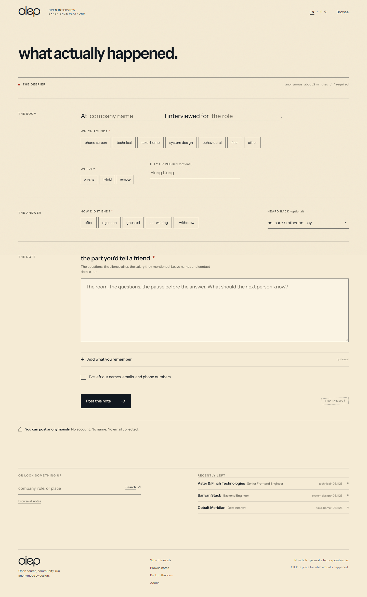
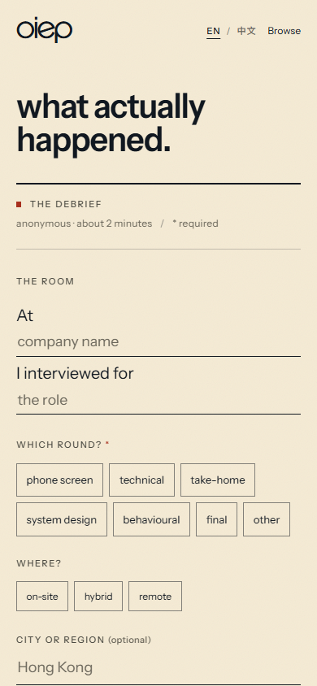

# OIEP

**Open Interview Experience Platform** — a non-profit, self-hosted, community-run collection of real interview experiences.

No polished marketing copy. No paywalls. No corporate spin. Just what actually happened, from the people who were in the room.

> “I want to hear your experience. Not mine.”

---

## Preview

**Desktop** — the debrief form is the page; the lookup section waits quietly below it.

[](docs/index-desktop.png)

**Mobile** — same hierarchy, single column, generous tap targets.

[](docs/index-mobile.png)

**Chinese (zh-HK)** — human-written standard written Traditional Chinese, not colloquial Cantonese and not machine-translated.

[](docs/index-zh-HK.png)

Screenshots use the optional demo reports (`--oiep.demo-data=true`); a fresh install starts empty.

---

## What is built

The first working slice:

- **Index** — one sentence, one large anonymous debrief form, one quiet trust line, then a subdued search/recent-notes section.
- **Submission** — company, role, round, where, outcome, heard-back timing, question types, salary, interviewer vibe, and the story itself. Progressively disclosed extras, client-side validation with friendly errors, and full server-side validation as the no-JS fallback.
- **Search / browse** — free-text search across company, role, location, story and question tags; filters for round, outcome and work mode; sort by newest or most useful; pagination.
- **Report detail** — published note, metadata, anonymous signoff, and a useful vote (once per browser session).
- **Bilingual UI** — English first, human-written standard written Traditional Chinese (`zh-HK`) available through the header toggle. Persisted in an `OIEP_LANG` cookie.
- **About** — the full “why this exists”, roadmap and tech-stack copy lives on `/about`, keeping the index focused on the form.
- **Admin / moderation** — password-protected `/admin` dashboard with note counts, search and status filters, hide/restore, delete-with-confirmation, CSRF tokens, login throttling, session rotation and no-store admin responses.
- **Ops basics** — SQLite out of the box, custom 404/500 pages, XSS-safe JSP output escaping, baseline security headers, honeypot, per-IP rate limiting, cookie-only sessions.
- **Deployment** — multi-stage Docker image, persistent SQLite volume, Cloudflare Tunnel service, backup/restore scripts, and a beginner-friendly guide at [docs/DEPLOY.md](docs/DEPLOY.md).

## Run it

Requirements: **JDK 17+**. Maven is not required; the Maven wrapper is included.

### Windows

```powershell
.\mvnw.cmd spring-boot:run
```

### macOS / Linux

```bash
./mvnw spring-boot:run
```

Then open <http://localhost:8080>.

The SQLite database is created automatically at `data/oiep.db` (WAL mode). To use another location, set `OIEP_DB_PATH` or override the datasource URL:

```bash
OIEP_DB_PATH=/var/lib/oiep/oiep.db java -jar target/oiep.war
java -jar target/oiep.war --spring.datasource.url="jdbc:sqlite:/absolute/path/oiep.db"
```

### Package and serve

```bash
./mvnw package
java -jar target/oiep.war
```

The executable WAR embeds Tomcat and serves the JSP views directly. No external servlet container is needed.

### Demo content (optional)

A fresh install is empty by design. For screenshots or a local walkthrough you can seed six short fictional reports:

```bash
java -jar target/oiep.war --oiep.demo-data=true
```

The seeder only runs when the reports table is empty, and the company names are deliberately fictional. Do not treat the demo notes as real experiences.

### Admin area

The admin area is **disabled until you set a password**. There is deliberately no default admin password in the repository.

Set both variables before starting the app:

```powershell
$env:OIEP_ADMIN_USERNAME = "admin"
$env:OIEP_ADMIN_PASSWORD = "choose-a-long-random-password"
java -jar target/oiep.war
```

```bash
OIEP_ADMIN_USERNAME=admin \
OIEP_ADMIN_PASSWORD='choose-a-long-random-password' \
java -jar target/oiep.war
```

Then open **<http://localhost:8080/admin>**. The link is also in the site footer.

[](docs/admin.png)

The admin login is throttled, CSRF-protected and session-based. It only lets you hide, restore or delete notes; it never exposes the password. For Docker, put `OIEP_ADMIN_PASSWORD` in `.env` before `docker compose up -d --build`.

### Docker (local)

With Docker Desktop (or Docker Engine) running:

```bash
docker compose up -d --build
```

Open <http://127.0.0.1:8080>. The database lives in the `oiep-data` Docker volume, so `docker compose down` keeps it; `docker compose down -v` deletes it.

### Deploy to the internet (Docker + Cloudflare)

The short honest version: **Cloudflare Pages cannot host this app.** Pages is a static-file host; OIEP is a Java/JSP server with a live SQLite database. The shipped deployment uses a small Docker server and **Cloudflare Tunnel**, so Cloudflare still provides DNS, HTTPS and its edge network without opening any inbound web ports.

The repo includes a multi-stage `Dockerfile`, `compose.yaml` with an optional `tunnel` profile, `.env.example`, and backup/restore scripts. Follow the step-by-step guide:

* **[Deploy OIEP on a VPS with Docker + Cloudflare Tunnel → docs/DEPLOY.md](docs/DEPLOY.md)**

## Routes

| Method | Path | Purpose |
| --- | --- | --- |
| `GET` | `/` | Index: anonymous debrief form + quiet lookup |
| `POST` | `/reports` | Validate and publish a note |
| `GET` | `/browse` | Search, filter and sort notes |
| `GET` | `/reports/{id}` | Read a note |
| `POST` | `/reports/{id}/helpful` | Mark a note useful (once per session) |
| `GET` | `/about` | The longer story, roadmap and stack |
| `GET` | `/language/{en\|zh-HK}` | Switch locale, safely redirect back |
| `GET` | `/admin` | Admin dashboard (login required) |
| `GET`, `POST` | `/admin/login` | Admin sign-in with CSRF token |
| `POST` | `/admin/logout` | End the admin session |
| `GET` | `/admin/reports/{id}` | Review a note inside the admin area |
| `POST` | `/admin/reports/{id}/hide` | Hide a note from the public board |
| `POST` | `/admin/reports/{id}/restore` | Restore a hidden note |
| `GET`, `POST` | `/admin/reports/{id}/delete` | Confirmation page and permanent deletion |

## Index design contract

The index follows the brief literally rather than treating it as a landing-page template:

1. **Top bar** — wordmark, language switch, Browse.
2. **Hero** — one sentence, nothing else. The title is Instrument Sans at `64px` on desktop; Y1CandyCore is reserved exclusively for the OIEP wordmarks in the header and footer.
3. **The debrief form** — the page’s primary object: a three-part field note (`the room`, `the answer`, `the note`), bare underlines, selectable chips, an optional details disclosure, and generous whitespace.
4. **Trust line** — “You can post anonymously.” directly under the form.
5. **Quiet secondary section** — a small search entry and up to three recent notes, visually subordinate and far down the page.

Body copy is Instrument Sans at `24px`; all headings, labels and UI copy also use Instrument Sans. The palette comes from the supplied brand reference: warm paper `#F5EBD5`, ink `#111820`, and a single correction-red `#A92F1D`. No gradients, no cards, no SaaS chrome.

## Accessibility and i18n

- Skip link, visible high-contrast focus rings, keyboard-operable chips/disclosures, 44px-class touch targets.
- Semantic headings, fieldsets/legends, accessible names, described-by errors, live status region, and an alert on server validation failure.
- Native form submission and native `<details>` still work without JavaScript; client-side validation and auto-applied browse filters are progressive enhancements.
- `prefers-reduced-motion` support, high-contrast preference support, print styles, and no horizontal overflow at 320px.
- Axe checks (WCAG 2.0/2.1/2.2 A/AA + best practice) are clean for the index, browse, about, report and error pages in both locales.
- Message bundles: `messages.properties` (English root) and `messages_zh_HK.properties` (human-written standard written Traditional Chinese, zh-HK; no colloquial Cantonese). `spring.messages.fallback-to-system-locale` is intentionally **false** so a server JVM running under `zh_HK` does not override the English default; zh-HK still falls back to the English root for any missing key.

## Privacy and security posture

- No accounts, names or emails are collected to post or search.
- The form is anonymous; the UI explicitly warns contributors not to include names or contact details.
- All output is escaped in JSP (`c:out` / `fn:escapeXml`); SQL uses prepared statements and escaped LIKE wildcards.
- Honeypot field + in-memory per-IP submission limit (8 posts / 10 minutes) provide basic abuse friction. If the app runs behind a trusted reverse proxy or Cloudflare, enable `server.forward-headers-strategy=framework` and configure the proxy/trust boundary — otherwise every visitor shares the proxy's single rate-limit bucket.
- Sessions are cookie-only (no `;jsessionid` in URLs) and only created when a note is posted or a useful vote is cast. A missing report ID does not allocate a session.
- Admin credentials are deployment environment variables, compared in constant time. Successful login rotates the session; admin mutations are POST-only and require a per-session CSRF token; login attempts are throttled per IP; admin responses are `no-store`.
- Hidden notes are excluded from the public browse/search, recent list and direct `/reports/{id}` route. Only an authenticated admin session can see or restore them.
- Baseline response headers: `Content-Security-Policy`, `X-Content-Type-Options: nosniff`, `X-Frame-Options: DENY`, `Referrer-Policy`, and `Permissions-Policy`.
- Custom error pages never expose stack traces or internal messages.

Current limitations before a larger public launch: the anonymous submission form does not use a CSRF token (it is not tied to an authenticated session), helpful votes are per-session rather than per-person, the rate limiter is single-instance and resets on restart, and there is no audit log of moderation actions. These are documented rather than hidden.

## Project structure

```
pom.xml
mvnw, mvnw.cmd, .mvn/                  Maven wrapper
Dockerfile                             multi-stage image, non-root runtime, healthcheck
compose.yaml                           app + persistent volume + optional Cloudflare Tunnel
.env.example                           copy to .env for production secrets
scripts/backup.sh, scripts/restore.sh  SQLite backup and restore helpers
docs/DEPLOY.md                         hand-holding deployment guide
src/main/java/com/oiep/
  config/                              JDBC/SQLite + locale configuration
  domain/                              form, read model, allowed-value registry
  repository/                          prepared SQLite queries
  service/                             demo seeder, useful-vote tracker, rate limiters, admin auth
  web/                                 MVC controllers, error controller, admin auth interceptor
src/main/resources/
  application.properties
  schema.sql
  messages.properties                  English root
  messages_zh_HK.properties            human-written standard written Traditional Chinese
  static/css/site.css                  the design system + page styles
  static/css/admin.css                 back-office layout
  static/js/site.js                    minimal vanilla progressive enhancement
  static/fonts/                        webfonts + OFL for Instrument Sans
src/main/webapp/WEB-INF/jsp/           JSP views and shared fragments
src/main/webapp/WEB-INF/jsp/admin/     admin login, dashboard, detail, delete pages
src/test/java/com/oiep/                55 tests
```

## Tests

```bash
./mvnw test
```

The suite covers:

- repository search/filter/pagination and helpful counters
- validation and persistence of submissions
- server-side error rendering (`422`) and rate-limited rendering (`429`)
- clean POST redirects with no session id in the URL
- locale switching, safe return URLs and message-bundle parity
- demo seeding only when explicitly enabled
- home/browse/report/about routes and the styled error path
- admin login redirects, CSRF rejection, login throttling, hide/restore/delete and hidden-report 404s

## Fonts and licensing

- **Instrument Sans** is licensed under the SIL Open Font License 1.1; the license text is included at `src/main/resources/static/fonts/OFL-InstrumentSans.txt`.
- **Y1CandyCore** is the brand face supplied by the project owner and is used **only** for the `oiep` wordmarks in the header and footer. It is a commercial font; confirm the license covers redistribution before publishing the repository or a public instance. The code does not grant rights to it. Every other heading, label, paragraph and user-generated report title uses Instrument Sans, with the system CJK stack for Chinese glyphs.
- No project-wide code/content license file has been added yet. Choose one (for example MIT, Apache-2.0, or AGPL-3.0) before calling the repository “open source” publicly, so forks and self-hosters know their rights.

## Roadmap

- [x] Core submission and search forms
- [x] Round/location/mode/outcome tagging and filtering
- [x] Lightweight usefulness rating
- [x] Admin moderation dashboard with hide/restore/delete and login protection
- [ ] Optional lightweight accounts for contributors/moderators
- [ ] Screenshot/attachment storage with local + optional S3/MinIO dual-write and an outbox reconciler
- [ ] Export and backup tools so the data stays portable

The platform is designed to run on a single VPS, Docker, or a Raspberry Pi. Cloudflare can front static assets if desired.
