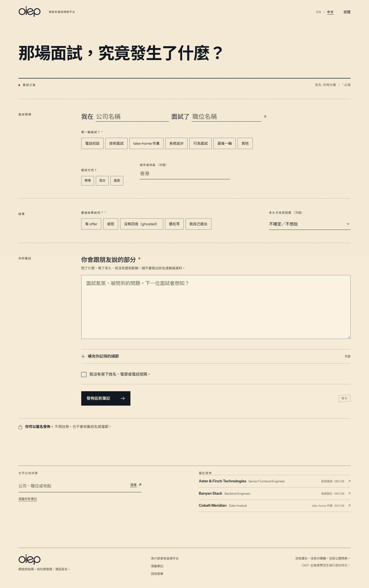
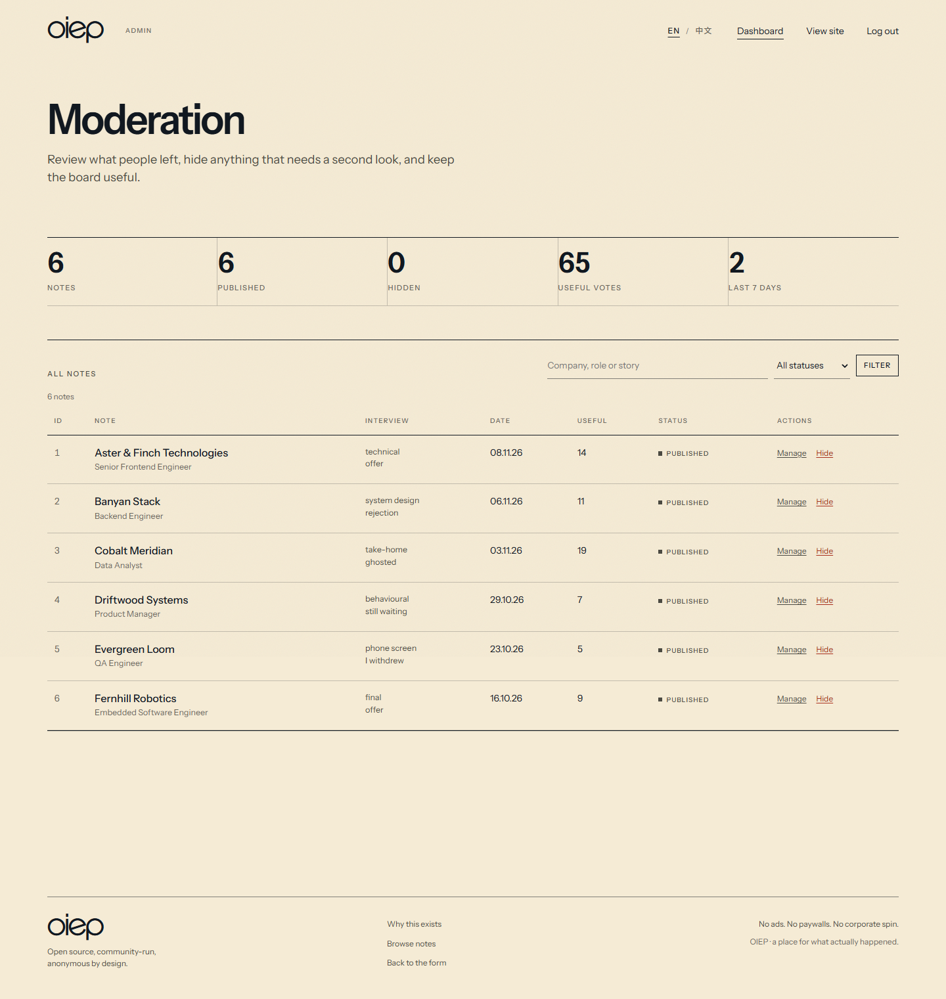

# OIEP

[](https://github.com/Coffet/oiep/actions/workflows/ci.yml)

**Open Interview Experience Platform** — a non-profit, self-hosted, solo coded work and community-run collection of real interview experiences.

No polished marketing copy. No paywalls. No corporate spin. Just what actually happened, from the people who were in the room.

> “I want to hear your experience. Not mine.”

---

## Preview

**Desktop** — the debrief form is the page; the lookup section waits quietly below it.

[](docs/index-desktop.png)

**Mobile** — same hierarchy, single column, generous tap targets.

[](docs/index-mobile.png)

**Chinese (zh-HK)** — human-written standard written Traditional Chinese, not colloquial Cantonese and not machine-translated.

[](docs/index-zh-HK.png)

Screenshots use the optional demo reports (`--oiep.demo-data=true`); a fresh install starts empty.

---

## What is built

The first working slice:

- **Index** — one sentence, one large anonymous debrief form, one quiet trust line, then a subdued search/recent-notes section.
- **Submission** — company, role, round, where, outcome, heard-back timing, question types, salary, interviewer vibe, and the story itself. Progressively disclosed extras, client-side validation with friendly errors, and full server-side validation as the no-JS fallback.
- **Search / browse** — free-text search across company, role, location, story and question tags; filters for round, outcome and work mode; sort by newest or most useful; pagination.
- **Report detail** — published note, metadata, anonymous signoff, and a useful vote (once per browser session).
- **Bilingual UI** — English first, human-written standard written Traditional Chinese (`zh-HK`) available through the header toggle. Persisted in an `OIEP_LANG` cookie.
- **About** — the full “why this exists”, roadmap and tech-stack copy lives on `/about`, keeping the index focused on the form.
- **Admin / moderation** — password-protected `/admin` dashboard with note counts, search and status filters, hide/restore, delete-with-confirmation, per-session CSRF tokens, login throttling plus a login-page throttle, session rotation, a hard server-side session cap and no-store admin responses. Failed sign-ins, throttling and moderation actions are written to the security log with the resolved client address.
- **Ops basics** — SQLite out of the box, custom 404/500 pages, XSS-safe JSP output escaping, hash-based CSP with HSTS-on-HTTPS/COOP/CORP/X-Frame-Options, honeypot, per-client rate limiting keyed on the real visitor IP (Cloudflare `CF-Connecting-IP`; client-supplied `X-Forwarded-For` is never trusted), same-origin checks on anonymous POSTs, and cookie-only sessions with `Secure`/`HttpOnly`/`SameSite=Lax`.
- **Deployment** — multi-stage Docker image, hardened Compose runtime (`cap_drop: ALL`, pids limits, no-new-privileges), persistent SQLite volume, Cloudflare Tunnel service, safe backup/restore scripts, Dependabot updates and a CI Docker smoke test that asserts the security headers, relative admin redirect and session-cookie flags.

## Run it

Requirements: **JDK 17+**. Maven is not required; the Maven wrapper is included.

### Windows

```powershell
.\mvnw.cmd spring-boot:run
```

### macOS / Linux

```bash
./mvnw spring-boot:run
```

Then open [http://localhost:8080](http://localhost:8080).

The SQLite database is created automatically at `data/oiep.db` (WAL mode). To use another location, set `OIEP_DB_PATH` or override the datasource URL:

```bash
OIEP_DB_PATH=/var/lib/oiep/oiep.db java -jar target/oiep.war
java -jar target/oiep.war --spring.datasource.url="jdbc:sqlite:/absolute/path/oiep.db"
```

### Package and serve

```bash
./mvnw package
java -jar target/oiep.war
```

The executable WAR embeds Tomcat and serves the JSP views directly. No external servlet container is needed.

### Demo content (optional)

A fresh install is empty by design. For screenshots or a local walkthrough you can seed six short fictional reports:

```bash
java -jar target/oiep.war --oiep.demo-data=true
```

The seeder only runs when the reports table is empty, and the company names are deliberately fictional. Do not treat the demo notes as real experiences.

### Admin area

The admin area is **disabled until you set a password**. There is deliberately no default admin password in the repository. Use a unique long random secret (16+ characters recommended); a placeholder copied verbatim from this repository's docs or `.env.example` is detected at startup and the admin area stays disabled, fail-closed.

Set both variables before starting the app:

```powershell
$env:OIEP_ADMIN_USERNAME = "admin"
# Replace the placeholder with your own long random secret; this exact placeholder is rejected at startup.
$env:OIEP_ADMIN_PASSWORD = "<paste-your-own-long-random-secret>"
java -jar target/oiep.war
```

```bash
OIEP_ADMIN_USERNAME=admin \
OIEP_ADMIN_PASSWORD='<paste-your-own-long-random-secret>' \
java -jar target/oiep.war
```

Then open **[http://localhost:8080/admin](http://localhost:8080/admin)** directly. The admin route is intentionally not linked from the public interface.

[](docs/admin.png)

The admin login is throttled, CSRF-protected and session-based. It only lets you hide, restore or delete notes; it never exposes the password. For Docker, put `OIEP_ADMIN_PASSWORD` in `.env` before `docker compose up -d --build`.

### Optional AI companion (oiep-backendAI)

A separate, optional service — [oiep-backendAI](https://github.com/Coffet/oiep-backendAI), a local-first FastAPI process — can be plugged in next to OIEP. It is **off by default**: leave `OIEP_COMPANION_ENABLED` unset (or `false`) and OIEP serves the same pages and headers as before, with no new routes, page fragments or CSP changes. (The component's static JS/CSS files stay in the built artifact and are still served while the component is disabled; nothing references them, and the full-removal procedure deletes them.)

When enabled, the component adds three independent surfaces:

- **User helper** — an optional web-chat widget: a compact launcher fixed to the bottom-right of the public form page opens the companion's own widget in a floating panel. The visitor's browser loads it directly from the companion's origin (OIEP only adds that exact origin to the CSP `frame-src`); the widget returns a prefill payload over `postMessage` and OIEP fills the matching form fields. Nothing is submitted automatically, and without JavaScript the launcher is a plain link to the standalone widget.
- **Read-only experiences API** — `GET /api/v1/experiences`, consumed by the companion's admin corpus sync with a dedicated read-only bearer token. Hidden/deleted notes are propagated as tombstones.
- **Admin helper** — `/admin/assistant` inside the existing admin area, proxied server-side so the companion's operator token never reaches the browser.

Enable it on bare metal with the environment variables documented in **[docs/COMPANION.md](docs/COMPANION.md)**, or run the optional Docker Compose overlay (the base `compose.yaml` is untouched):

```bash
docker compose -f compose.yaml -f compose.companion.yaml up -d --build
```

The overlay builds the companion from a sibling `../oiep-backendAI` checkout (or an `OIEP_AI_IMAGE`), publishes it on loopback only, and wires the `app` environment. Soft-disable at any time with `OIEP_COMPANION_ENABLED=false`; the exact add/remove procedure — including the `scripts/companion-uninstall.sql` database step — is in [docs/COMPANION.md](docs/COMPANION.md).

> OIEP does not ask for interview difficulty or a multi-round history, so the companion's mirror carries a synthesized `difficulty` value and exactly one round entry per note. That limitation is stated plainly in the companion documentation.

### Docker (local)

With Docker Desktop (or Docker Engine) running:

```bash
docker compose up -d --build
```

Open [http://127.0.0.1:8080](http://127.0.0.1:8080). The database lives in the `oiep-data` Docker volume, so `docker compose down` keeps it; `docker compose down -v` deletes it.

`compose.yaml` sets `OIEP_SESSION_COOKIE_SECURE=true` because the shipped deployment is HTTPS (TLS terminates at Cloudflare), so the session cookie is marked `Secure`. For a local plain-HTTP walkthrough of the admin area add `OIEP_SESSION_COOKIE_SECURE=false` to `.env` before `docker compose up` — otherwise the browser will not send the `Secure` session cookie over `http://` and login cannot complete. Never set it to `false` on a public HTTPS deployment.

### Deploy to the internet (Docker + Cloudflare)

The short honest version: **Cloudflare Pages cannot host this app.** Pages is a static-file host; OIEP is a Java/JSP server with a live SQLite database. The shipped deployment uses a small Docker server and **Cloudflare Tunnel**, so Cloudflare still provides DNS, HTTPS and its edge network without opening any inbound web ports.

The repo includes a multi-stage `Dockerfile`, `compose.yaml` with an optional `tunnel` profile, `.env.example`, and backup/restore scripts. Follow the step-by-step guide:

* **[Deploy OIEP on a VPS with Docker + Cloudflare Tunnel → docs/DEPLOY.md](docs/DEPLOY.md)**

## Routes


| Method        | Path                          | Purpose                                      |
| ------------- | ----------------------------- | -------------------------------------------- |
| `GET`         | `/`                           | Index: anonymous debrief form + quiet lookup (plus the optional AI helper when enabled) |
| `POST`        | `/reports`                    | Validate and publish a note                  |
| `GET`         | `/browse`                     | Search, filter and sort notes                |
| `GET`         | `/reports/{id}`               | Read a note                                  |
| `POST`        | `/reports/{id}/helpful`       | Mark a note useful (once per session)        |
| `GET`         | `/about`                      | The longer story, roadmap and stack          |
| `GET`         | `/language/{en|zh-HK}`        | Switch locale, safely redirect back          |
| `GET`         | `/admin`                      | Admin dashboard (login required)             |
| `GET`, `POST` | `/admin/login`                | Admin sign-in with CSRF token                |
| `POST`        | `/admin/logout`               | End the admin session                        |
| `GET`         | `/admin/reports/{id}`         | Review a note inside the admin area          |
| `POST`        | `/admin/reports/{id}/hide`    | Hide a note from the public board            |
| `POST`        | `/admin/reports/{id}/restore` | Restore a hidden note                        |
| `GET`, `POST` | `/admin/reports/{id}/delete`  | Confirmation page and permanent deletion     |
| `GET`         | `/admin/assistant`            | Optional AI companion: operator helper page (admin session) |
| `GET`, `POST` | `/admin/assistant/api/**`     | Optional AI companion: same-origin proxy to the companion admin API (admin session + CSRF) |
| `GET`         | `/api/v1/experiences`         | Optional AI companion: read-only experiences API for the companion's corpus sync (bearer token) |

## Index design contract

The index follows the brief literally rather than treating it as a landing-page template:

1. **Top bar** — wordmark, language switch, Browse.
2. **Hero** — one sentence, nothing else. The title is Instrument Sans at `64px` on desktop; Y1CandyCore is reserved exclusively for the OIEP wordmarks in the header and footer.
3. **The debrief form** — the page’s primary object: a three-part field note (`the room`, `the answer`, `the note`), bare underlines, selectable chips, an optional details disclosure, and generous whitespace.
4. **Trust line** — “You can post anonymously.” directly under the form.
5. **Quiet secondary section** — a small search entry and up to three recent notes, visually subordinate and far down the page.

Body copy is Instrument Sans at `24px`; all headings, labels and UI copy also use Instrument Sans. The palette comes from the supplied brand reference: warm paper `#F5EBD5`, ink `#111820`, and a single correction-red `#A92F1D`. No gradients, no cards, no SaaS chrome.

## Accessibility and i18n

- Skip link, visible high-contrast focus rings, keyboard-operable chips/disclosures, 44px-class touch targets.
- Semantic headings, fieldsets/legends, accessible names, described-by errors, live status region, and an alert on server validation failure.
- Native form submission and native `<details>` still work without JavaScript; client-side validation and auto-applied browse filters are progressive enhancements.
- `prefers-reduced-motion` support, high-contrast preference support, print styles, and no horizontal overflow at 320px.
- Axe checks (WCAG 2.0/2.1/2.2 A/AA + best practice) are clean for the index, browse, about, report and error pages in both locales.
- Message bundles: `messages.properties` (English root) and `messages_zh_HK.properties` (human-written standard written Traditional Chinese, zh-HK; no colloquial Cantonese). `spring.messages.fallback-to-system-locale` is intentionally **false** so a server JVM running under `zh_HK` does not override the English default; zh-HK still falls back to the English root for any missing key.

## Privacy and security posture

- No accounts, names or emails are collected to post or search. (A short-lived server-side session is used to hold the admin/login CSRF token and the once-per-session useful-vote marker only.)
- The form is anonymous; the UI explicitly warns contributors not to include names or contact details.
- All output is escaped in JSP (`c:out` / `fn:escapeXml`); SQL uses prepared statements and escaped LIKE wildcards.
- Abuse friction: a honeypot field plus in-memory per-client limits — 8 submissions / 10 minutes and 30 useful votes / hour — keyed on the resolved client address. Anonymous `POST`s are also checked for same-origin browser provenance (`Origin`, else `Sec-Fetch-Site`, else `Referer`); non-browser clients that send none of those headers are allowed (the endpoints are anonymous and carry no ambient browser credentials).
- Client address: behind the shipped Cloudflare Tunnel the real visitor IP arrives in `CF-Connecting-IP` (`OIEP_TRUST_CLOUDFLARE_CONNECTING_IP=true`) and Tomcat's native `RemoteIpValve` only honours it from the trusted `cloudflared` hop. Client-supplied `X-Forwarded-For` / `Forwarded` headers are never used for limits or logs, so rotating them cannot bypass a throttle. If you front the app with a different proxy, configure its trusted hop instead of trusting client headers. Keep `OIEP_TRUST_CLOUDFLARE_CONNECTING_IP` enabled only while the app port stays bound to `127.0.0.1` behind Cloudflare Tunnel; the app applies `CF-Connecting-IP` only when Tomcat's trusted-proxy handling has already rewritten the peer address to the same value.
- Sessions are cookie-only (no `;jsessionid` in URLs). The session cookie is `HttpOnly`, `SameSite=Lax`, and `Secure` when `OIEP_SESSION_COOKIE_SECURE=true` (Compose default for the HTTPS deployment). The `OIEP_LANG` locale cookie uses the same `HttpOnly`/`SameSite=Lax`/`Secure` policy, tied to the same setting. A session is allocated only for a posted note, a useful vote, or the admin login form (and not at all while admin is disabled or when CSRF validation fails). The login page is throttled per client and a hard global cap (`OIEP_SESSIONS_MAX_ACTIVE`, default 10000) bounds server-side sessions.
- Admin credentials are deployment environment variables, compared in constant time over SHA-256 digests. Successful login rotates the session; admin mutations are POST-only and require a per-session CSRF token; the login throttle is per client and fails closed; admin responses are `no-store`. A failed sign-in, a throttled sign-in, a logout and every hide/restore/delete are logged with the resolved client address.
- Hidden notes are excluded from the public browse/search, recent list and direct `/reports/{id}` route. Only an authenticated admin session can see or restore them.
- Response headers: `Content-Security-Policy` with per-inline SHA-256 hashes (no `'unsafe-inline'`), `X-Content-Type-Options: nosniff`, `X-Frame-Options: DENY`, `Referrer-Policy`, `Permissions-Policy`, `Cross-Origin-Opener-Policy: same-origin`, `Cross-Origin-Resource-Policy: same-origin` and `X-Permitted-Cross-Domain-Policies: none`. `Strict-Transport-Security` is sent only on HTTPS responses. Dynamic HTML is `Cache-Control: no-cache` with `Vary: Cookie`, while static assets stay cacheable.
- Redirects are emitted as relative `Location` headers, so a forged `Host`/`X-Forwarded-Host` header cannot turn an app redirect into a cross-host open redirect.
- Custom error pages never expose stack traces or internal messages.

Current limitations before a larger public launch: useful votes are tracked per browser session (now additionally throttled per client, but still not per-person); the rate limiters, login throttle and session cap are single-instance in-memory structures that reset on restart (the app is designed for one container against one SQLite file); the login throttle fails closed, so repeated failures from a shared egress IP — including the admin's own — can lock the admin out for the 15-minute window; the single admin account has no MFA; and the app-level limiters are abuse friction, not a substitute for an external WAF (Cloudflare's edge protection is the network-level layer). The session cap admits new sessions atomically, so a concurrent burst cannot overshoot it; however a client able to hold the cap open (for example by rotating addresses) can make new sessions receive `503` until slots expire, and a successful sign-in can still be blocked by the login-page throttle for the same window. Security events go to the container's stdout log only — ship them off-host if you need retention or alerting. Docker and Cloudflare wiring are verified locally (CI smoke test plus a local Docker stack); a real named Cloudflare Tunnel needs your own account, as described in [docs/DEPLOY.md](docs/DEPLOY.md).

## Project structure

```
.github/workflows/ci.yml               tests + Docker smoke with security-header/cookie assertions
.github/dependabot.yml                 weekly Maven, GitHub Actions and Docker update PRs
pom.xml
mvnw, mvnw.cmd, .mvn/                  Maven wrapper
Dockerfile                             multi-stage image, non-root runtime, healthcheck, hardened /data
compose.yaml                           app + persistent volume + hardened runtime + optional Cloudflare Tunnel
compose.companion.yaml                 optional AI companion Docker Compose overlay (adds the `ai` service)
.env.example                           copy to .env for production secrets
scripts/backup.sh, scripts/restore.sh  SQLite backup/restore helpers (0600 backups, guarded restore)
scripts/companion-uninstall.sql        drops the optional companion's read-API triggers/table (removal step)
docs/DEPLOY.md                         hand-holding deployment guide
docs/COMPANION.md                      optional AI companion reference, config and add/remove procedure
src/main/java/com/oiep/
  companion/                           optional AI companion component: user helper, admin proxy, read API
  config/                              JDBC/SQLite + locale + CSP configuration
  domain/                              form, read model, allowed-value registry
  repository/                          prepared SQLite queries
  service/                             demo seeder, useful-vote tracker, rate limiters, admin auth
  web/                                 MVC controllers, error controller, admin auth interceptor
src/main/resources/
  application.properties
  schema.sql
  messages.properties                  English root
  messages_zh_HK.properties            human-written standard written Traditional Chinese
  messages-companion.properties        optional AI companion, English
  messages-companion_zh_HK.properties  optional AI companion, zh-HK
  static/css/site.css                  the design system + page styles
  static/css/admin.css                 back-office layout
  static/css/companion.css             optional user-helper styles
  static/css/companion-admin.css       optional admin-helper styles
  static/js/site.js                    minimal vanilla progressive enhancement
  static/js/companion.js               optional user-helper prefill bridge (postMessage, no auto-submit)
  static/js/companion-admin.js         optional admin-helper page script
  static/fonts/                        webfonts + OFL for Instrument Sans
src/main/webapp/WEB-INF/jsp/           JSP views and shared fragments
src/main/webapp/WEB-INF/jsp/admin/     admin login, dashboard, detail, delete pages
src/main/webapp/WEB-INF/jsp/companion/ optional user-helper and admin-helper views
src/test/java/com/oiep/                322 tests
```

## Tests

```bash
./mvnw test
```

The suite covers:

- repository search/filter/pagination and helpful counters
- validation and persistence of submissions
- server-side error rendering (`422`) and rate-limited rendering (`429`)
- clean POST redirects with no session id in the URL
- locale switching, safe return URLs and message-bundle parity
- demo seeding only when explicitly enabled
- home/browse/report/about routes and the styled error path
- admin login redirects, CSRF rejection, login throttling, hide/restore/delete and hidden-report 404s
- the optional AI companion: disabled-by-default behaviour (no routes, page snippets or CSP changes), the user-helper fragment and prefill bridge, the read-API contract/auth/pagination/tombstones, and the admin proxy (admin session, CSRF, allowlists, `502` on failure)

GitHub Actions runs the same `./mvnw -B -ntp verify` suite on every push and pull request, then builds the Docker image and smoke-tests `/`, the security headers (CSP SHA-256 hashes with no `'unsafe-inline'`, `nosniff`, `X-Frame-Options: DENY`, COOP), the relative `/admin` redirect and the session-cookie flags (`Secure`/`HttpOnly`/`SameSite=Lax`). Dependabot opens weekly Maven, GitHub Actions and Docker base-image update pull requests.

## Fonts and licensing

- **Instrument Sans** is licensed under the SIL Open Font License 1.1; the license text is included at `src/main/resources/static/fonts/OFL-InstrumentSans.txt`.
- **Y1CandyCore** is the brand face supplied by the project owner and is used **only** for the `oiep` wordmarks in the header and footer. It is a commercial font; confirm the license covers redistribution before publishing the repository or a public instance. The code does not grant rights to it. Every other heading, label, paragraph and user-generated report title uses Instrument Sans, with the system CJK stack for Chinese glyphs.
- No project-wide code/content license file has been added yet. Choose one (for example MIT, Apache-2.0, or AGPL-3.0) before calling the repository “open source” publicly, so forks and self-hosters know their rights.

## Roadmap

- [X]  Core submission and search forms
- [X]  Round/location/mode/outcome tagging and filtering
- [X]  Lightweight usefulness rating
- [X]  Admin moderation dashboard with hide/restore/delete and login protection
- [ ]  Optional lightweight accounts for contributors/moderators
- [ ]  Screenshot/attachment storage with local + optional S3/MinIO dual-write and an outbox reconciler
- [ ]  Export and backup tools so the data stays portable

The platform is designed to run on a single VPS, Docker, or a Raspberry Pi. Cloudflare can front static assets if desired.
